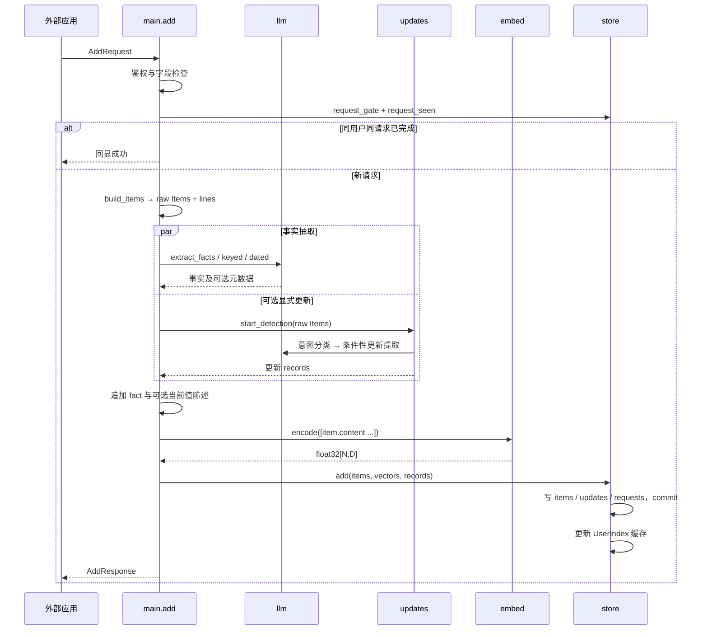
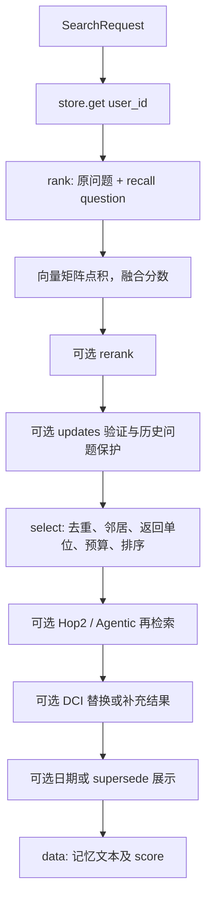

# AMI：Agent Memory 框架结构与集成研究

研究目标：理解消息如何成为记忆、各模块如何协作，以及记忆服务怎样接入一个完整
Agent。小样本执行记录用于验证调用链和数据结构，不用两题成绩评价框架优劣。
本文对应本仓库代码（2026-10-10），核心实现来自 ActiveMemoryIndex 上游，来源见
[ATTRIBUTION.md](ATTRIBUTION.md)。

## 1. 先划定系统边界

AMI 提供 `/add`、`/search`、`/health`，其核心接口是“写入记忆”和“检索记忆”。
一个完整 Agent 还需要处理当前用户消息、构造上下文、生成答案以及执行任务。
这些职责在本服务之外，研究时要分别观察。


本次 `reproduction/locomo_session.py` 同时扮演外部应用和回答器：它调用真实
FastAPI 路由，然后将返回的记忆交给 Qwen。回答模型是测试脚本增加的步骤，
`app.main._search()` 本身返回 `data`，不会直接生成最终答案。

## 2. 模块职责与依赖

| 模块 | 负责什么 | 主要调用谁 | 输入 / 输出 |
|---|---|---|---|
| `app/main.py` | 请求校验、鉴权、准入、生命周期、写入/检索编排 | 下列核心模块 | API 请求 → API 响应 |
| `app/config.py` | 从环境变量读取配置 | 无核心业务依赖 | 环境变量 → 模块级配置值 |
| `app/llm.py` | 提示词、模型调用、输出解析 | config、模型 SDK | 文本 → 事实、改写问题、更新判断等 |
| `app/embed.py` | 向量生成、分段、归一化、响应校验 | config、远程 SDK 或本地模型 | `list[str]` → `float32[N,D]` |
| `app/store.py` | 数据库、幂等标识、缓存与辅助索引 | config；初始化时调用 embed 的身份接口 | Item + 向量 → 持久数据 / UserIndex |
| `app/updates.py` | 显式更新生命周期 | llm、store、config | raw → 更新记录；用户历史 → 隐藏 ID 集 |
| `app/rerank.py` | 候选重排 | config、store 类型、本地 CrossEncoder | 用户索引 + 分数 → 新分数 |
| `app/dci.py` | 工具式记忆搜索 | llm、store 类型、config | 用户索引 + 问题 → 已有 Item 列表 |
| `reproduction/` | 启动环境、替换客户端、验证和外部 reader | 核心服务、SDK | 配置/数据集 → 运行记录 |

`main.py` 是集成中心。框架目前通过函数和共享模块状态协作，没有统一的插件注册器、
依赖注入容器或可配置工作流图。可选功能主要由环境开关和分支接入。

### 配置何时生效

`config.py` 在导入时读取环境，LLM 信号量等对象也会在导入时建立。
因此启动器必须先加载配置，再导入业务模块；只在导入后修改环境变量，不会自动重建
所有配置与客户端。这解释了 `reproduction/serve.py` 的初始化顺序。

服务 startup 顺序是：鉴权配置检查 → `store.init()` → `embed.warm_up()` → 可选
`rerank.warm_up()`。远程 embedding 预热本身会访问 provider。

## 3. 用数据契约连接功能

| 数据对象 | 内容 | 谁生成 / 谁使用 |
|---|---|---|
| `Message` | role、content、可选毫秒 timestamp | 外部应用 → main |
| `AddRequest` | request_id、user_id、session_id、messages | 外部应用 → main |
| `Item` | id、kind、content、created_at 等 | main → embed / store / 检索策略 |
| 抽取输入 `lines` | 带 role 和可选时间前缀的消息文本 | build_items → llm |
| 向量矩阵 | 第 i 行对应第 i 个 Item；`float32[N,D]` | embed → store / rank |
| 更新记录 | item_id、subject、attribute、新旧值、statement 等 | updates → store |
| `UserIndex` | items、matrix、by_id、by_chunk、by_key | store → 检索功能 |
| 分数数组 | 第 i 项对应 UserIndex 的第 i 条记忆 | rank / rerank → select |
| 候选结果 | `list[tuple[Item, float]]` | select / DCI → 响应构造 |
| Search 响应 | id、content、score、可选 created_at | main → 外部上下文构造 |

需要区分三种表示：

1. 模型输入文本：由 `item.content` 构成，不直接携带整个 Item 对象。
2. 存储对象：文本、标识、时间等元数据加对应向量。
3. 检索响应：供外部应用使用的记忆文本和分数，不返回向量。

raw 和 fact 是两种存储类型。显式更新产生的“当前值陈述”也使用 fact 类型；
结构化 updates 则单独存表。因此“三种文本来源”不是固定三条记忆或三个向量字段。

`parent_id` 在基础 Add 路径中为 None；raw 与同批 facts 的来源关系主要通过 Item ID
的共同 digest 恢复。`user_id` 控制检索范围，`session_id` 保存来源，不限制检索。

## 4. 写入流程：编排、加工和提交

源码入口：`main.add()`、`main.build_items()`、`store.add()`。



并行的是事实抽取和更新检测。`start_detection()` 提交 raw 列表的副本，main 后续
追加 fact 不会改变检测任务看到的列表。main 等待更新检测结果后，统一向量化所有
准备保存的 Item，避免单独给每个功能维护一套向量库。

写入前的职责分界：llm 负责事实输出及解析，updates 检查更新的引用和新值依据，
embed 校验向量，store 校验与数据库身份一致后持久化。

`store.add()` 将文本直接存到 `content TEXT`，将 `vectors[i].tobytes()` 存到
`vec BLOB`。正常路径提交后才更新缓存、返回响应。`request_gate` 防止同一个
请求并发重复执行，requests 表使幂等状态跨重启保留；它不比较重试请求体。
当前函数没有显式的异常 rollback 分支，commit 后的缓存异常恢复也不是自动完成的。

## 5. 检索流程：打分、选择、组织证据

源码入口：`main.search()`、`main._search()`、`main.rank()`、`main.select()`。



### 打分与选择为什么分开

`rank()` 生成对用户全部记忆的分数。归一化向量的点积即余弦相似度，原问题与
recall question 按权重融合。这样问题改写可以调整检索信号，而不直接改动记忆。

`select()` 决定哪些证据真正返回：排序候选、跳过隐藏项、按内容去重、补上下文、
消耗 top_k 与字符预算，再调用 `order()`。去重键为小写及空白归一化后的前 120 字符，
不是完整语义去重。当前字符预算允许首条记忆超预算后终止；不能视为严格截断器。

因此原始向量 top-k、最终选中记忆和最终排列顺序是三件不同的事。邻居占返回名额，
raw-first 也会改变位置。新增功能应先确定它影响“打分”“选中集合”还是“展示”。

### 显式更新跨越写入与检索

Add 检测并存储更新。Search 找候选旧项、让 verifier 核对替换关系，并把 verdict
写入 update_checks 表，减少重复验证。然后历史/时间问题保护决定此次是否隐藏旧项。
它是“保留历史，按问题组织证据”，不直接删除旧文本。

Search 因此不完全是只读操作。查询还可能产生模型调用、数据库检查记录和缓存更新。
router 失败时保护历史，不隐藏；部分 verifier 失败时，其他有效判断仍可能用于隐藏。

## 6. 可选功能如何接入，如何相互影响

下表“模板”指 `.env.example`，不等同于所有 `config.py` 默认值。

| 功能 | 接入阶段 | 依赖 / 输出 | 模板 | 集成影响 |
|---|---|---|---|---|
| 事实抽取 | Add 加工 | llm → fact Items | 开 | 增加记忆行和 embedding 输入 |
| recall query | rank | llm → 一个改写问题 | 开 | 增加查询向量，改变分数 |
| 显式更新 | Add 与 Search | llm + store → records / 隐藏 ID | 开，v7 | 持久状态与查询保护共同影响返回集合 |
| 邻居扩展 | select | by_id → 同批前后 raw | 半径 1 | 相关片段占用 top_k，增加上下文 |
| fact evidence | select | by_chunk + 分数 → 原始证据 | 关 | fact 命中带出来源 raw |
| fact select | rank | 将非 fact 分数置负无穷 | 关 | 改变直接候选范围，需理解证据扩展 |
| chunk memory | select | 同批 raw → 拼接 Item | 关 | 返回单位变为 chunk，绕过邻居/evidence 扩展 |
| rerank | 首轮 rank 之后 | CrossEncoder → 候选分数 | 关 | 候选池优先，池外仍保留原相对顺序 |
| Hop2 | 初次 select 之后 | reflect → 第二轮 rank | 关 | 预留名额、去重、共用剩余预算 |
| Agentic | 初次选择 / Hop2 之后 | reflect → 第二轮 rank | 关 | 两轮分数取最大值，再重新 select |
| DCI / DCI_FILL | 向量流程之后 | grep/read/finish → Item IDs | 关 | 替换结果，或优先加入工具结果再填充 |
| event dates | Add 或输出展示 | llm / event_date → 时间信息 | 关 | 存储元数据与展示计算是不同路径 |
| fact keys / supersede | Add / 输出展示 | 属性 key / 后继事实 → 标记 | 关 | 可按属性关联后续事实，不等于显式更新 |

三个值得关注的集成细节：

- DCI 开启后，基础向量检索仍先执行，作为回退和可选填充来源。成功的空列表与
  失败返回 None 也不同，后者触发回退。
- Hop2 和 Agentic 的合并方法不同：一个分配名额，一个合并分数。它们按代码顺序
  执行，不能假定一起开启等于互不影响的功能叠加。
- 普通检索的 score 是融合相似度，rerank 会重构分数，DCI 使用顺序分数，邻居可能
  继承主命中项分数。score 的语义随路径变化，不是统一概率或可直接跨模式比较的置信度。

当前多功能组合由 main 中显式分支控制。尤其返回单位、隐藏 ID、预算和排序策略的
组合，应对照这些接口研究，而不是仅看某个开关的局部实现。

## 7. 存储与运行保障也属于框架

SQLite 是持久来源，UserIndex 是按用户缓存的工作视图。`_load()` 使用 user_id
过滤、按 seq 读取，再用 `np.frombuffer(blob, dtype=np.float32)` 恢复矩阵。
by_id/by_chunk/by_key 支持证据组织，不是额外的 ANN 向量检索索引。

用户内检索通过 NumPy 全量矩阵运算完成。缓存淘汰不删除数据库内容，且至少保留
一个用户索引。重启可恢复记忆、requests 和 update_checks；纯内存缓存会重建。

运行保障分为三层：

1. `AdmissionValve`：ASGI 请求准入，限制进入 Add/Search 的并发工作。
2. LLM / embedding 的 semaphore：限制模型调用并发，与请求准入是不同的粒度。
3. store 的 RLock、同请求 request_gate、updates 的用户锁：保护共享状态及重复操作。

这些是进程内机制。启动器使用单 worker；不能仅因 SQLite 支持多连接就推断多个
worker 的缓存具有一致性。store 的锁也不覆盖整个 Search 的全部评分过程。

失败策略是模块间契约的一部分：普通抽取失败可仅保存 raw；recall 失败用原问题；
临时 embedding 故障在 Add 持久化前映射为 429/503；DCI 失败回退基础结果。
换 provider 的 native bridge 抛出普通 RuntimeError，与 OpenAI SDK 的临时异常映射
不同，研究适配时要同时核对调用格式和失败语义。

## 8. 换模型、换存储、接 Agent 分别改哪里

| 集成任务 | 当前接入位置 | 必须保留的契约 |
|---|---|---|
| 换 LLM provider | llm 客户端 / 启动器 | prompt 任务、JSON 解析、并发、异常与返回格式 |
| 换 embedding provider | embed 客户端 / transport bridge | 输入顺序、维度、归一化、长文本策略、数据库 identity |
| 换持久存储 | store 的写入、读取和幂等接口 | Item/向量对齐、user 隔离、来源关系、提交后可检索 |
| 换检索策略 | rank / rerank / select / DCI | 对齐索引、隐藏项、去重、返回数量、预算、结果格式 |
| 接入外部 Agent | Add/Search 接口及 Agent 的上下文构造 | 稳定用户标识、消息来源、记忆注入和回答职责 |

现有研究入口通过替换私有客户端实现模型适配，并没有形成正式的 provider 抽象。
若以后做通用框架，应先明确定义这些接口，再决定是否抽成类或插件。

外部 Agent 的最小集成伪代码：

```python
# 在应用选定的时机写入已有对话，稳定 request_id 用于重试。
memory.add(user_id=user_id, session_id=session_id,
           request_id=request_id, messages=conversation_chunk)

# 回答前获取历史证据，再由应用构造上下文。
memories = memory.search(user_id=user_id, query=current_question, top_k=10)
answer = agent_model.generate(current_question, memory_context=memories)
```

写入时机由外部应用决定，AMI 不自动收集整个 Agent 的工具轨迹或所有中间推理。

## 9. 小样本怎样用于结构研究

本次执行形成一条可以逐层对照的数据链：

```text
18 条带人名的 Message
  → 18 raw + 18 fact，未检测到显式更新
  → list[str]，36 条记忆文本
  → float32[36,1024]
  → SQLite 36 行，每行向量 BLOB 4096 字节
  → 两道问题分别 rank/select，返回 10 条记忆
  → 外部 Qwen reader 回答
```

其中日期题的原始证据已经召回，但 reader 将“昨天”解释为会话当天。
结构研究时应分别检查事实表示、时间字段、返回证据和 reader 输入，不能仅用最终
答案归因于 store 或 rank。这次执行报告位于 gitignored 的
`artifacts/locomo-qwen-once/report.json`；具体测试方式见
[LOCOMO_SMOKE.md](reproduction/LOCOMO_SMOKE.md)。

这条样本链已覆盖基础写入、抽取、向量化、持久化、查询改写、选择和外部 reader；
没有触发显式更新、DCI、重排或第二轮检索，不能作为那些分支的运行证据。

## 10. 评测层在哪里

`app/` 的职责是 Add/Search 服务，不自动加载数据集或评判答案。当前仓库周边有三种
验证或评测工具，应分别看待：

| 层次 | 入口 | 检查什么 | 当前边界 |
|---|---|---|---|
| 单元及机制测试 | tests/、reproduction/run_tests.py | 解析、幂等、用户隔离、更新规则、并发等 | fake 模型验证实现行为，不衡量真实模型质量 |
| HTTP 集成检查 | reproduction/check_http.py、scripts/smoke_contract.py | Add/Search 响应、鉴权、持久化、重启等 | 本地接口检查，不是平台正式 Smoke/Full |
| 数据集小样本评测 | reproduction/locomo_session.py | 原始证据召回、回答 token F1、BLEU1、请求用量与费用估算 | 单 session 两题，无正式 LLM judge、无完整 benchmark 汇总 |

上游 README 提到离线 `bench/` LoCoMo harness，但本复现仓库没有复制该目录，不能
直接按上游 benchmark 命令运行。外部 `LoCoMo_refined` 数据集另有 `src/evaluate.py`、
`src/llm_judge_runtime.py` 和 `scripts/run_eval.sh`，可以读取标准 predictions.jsonl；
它们属于数据集评测层，尚未被整合成 AMI 的完整端到端评测入口。

若进一步设计评测层，数据集适配器应先把会话变成 Add 请求，问题经 Search 与外部
reader 产生预测，再由独立 scorer 读取参考答案。这样可以分别研究写入表示、检索
证据和阅读答案，且避免参考答案进入记忆构建或回答上下文。

## 11. 源码阅读路线与研究产出

| 顺序 | 阅读入口 | 要回答的问题 |
|---|---|---|
| 1 | main 的 Message / AddRequest / SearchRequest / startup | 服务接收什么，配置和生命周期如何建立？ |
| 2 | build_items → add → llm.extract_facts | 原始消息怎样加工成记忆？ |
| 3 | embed.encode → store.add → UserIndex.append | 文字、向量和元数据怎样保持对齐？ |
| 4 | store.get / _load → rank → select → order | 数据怎样成为返回证据？ |
| 5 | updates.detect / resolve / withheld → main 的保护逻辑 | 更新状态怎样跨请求影响检索？ |
| 6 | Hop2 / Agentic → dci.run → rerank.rescore | 增强功能插入哪一阶段，改变什么？ |
| 7 | serve / native_embedding / locomo_session | 环境、模型适配和外部 Agent 怎样接入？ |

比较其他 Agent Memory 框架时，沿用这些维度：记忆表示、写入决策、更新生命周期、
检索与证据组织、持久化与隔离、外部 Agent 接口、可扩展性和失败策略。先建立
可对照的结构表，再决定哪些小样本有必要用于验证具体功能。
